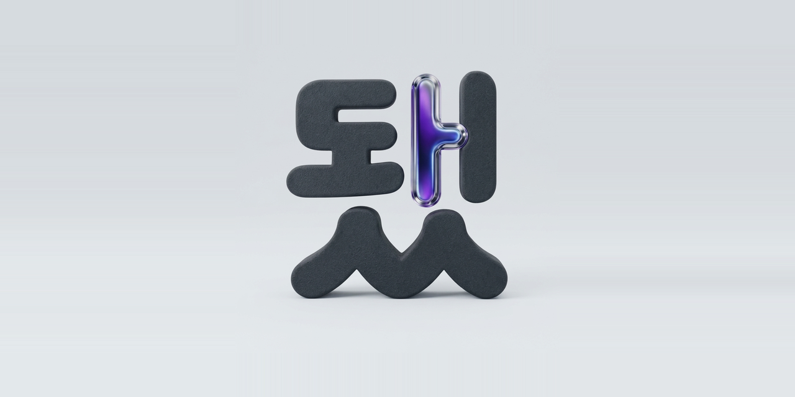
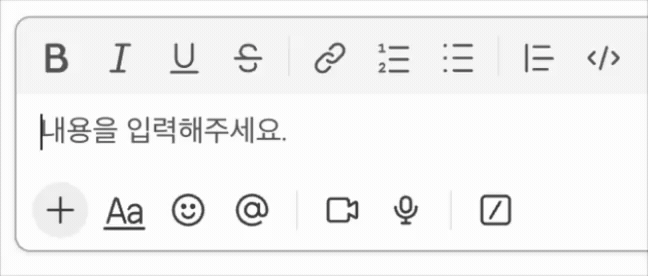

<p align="center">
  
</p>
<p align="center"><sub>로고는 Google Gemini로 생성한 이미지입니다.</sub></p>

<p align="center">
  
</p>

# ehlt-to-ehot — 한글 오타 교정 폰트 패처 (macOS)

자주 틀리는 한글 음절(`됬`, `떄`, `꺠` …)을 **올바른 글자로 그려주는 폰트**를 만들어 설치한다.

> ### 원문은 수정하지 않는다 — 보이는 모양(렌더링)만 바뀐다.
> 폰트의 **글리프만** 교체하므로, 메시지·파일의 **실제 글자 코드는 그대로**다.
> 텍스트를 건드리지 않으니 안전하고, **되돌리기도 폰트 삭제 한 번**이면 끝이다.
> (내부 데이터는 원래 입력된 글자 그대로 — 화면 표시만 올바른 글자로 보인다.)

## 동작 방식
1. 내 Mac의 `Apple SD Gothic Neo`(모든 macOS 기본)에서 폰트를 **복사**한다.
2. 폰트의 cmap에서 **잘못된 음절의 코드포인트를 올바른 음절의 글리프로 리맵**한다.
   (예: `됬`(U+B42C) → `됐`의 글리프.) 따로 지정한 음절만 바뀌고 나머지는 그대로다.
3. 패치한 폰트를 `~/Library/Fonts`에 설치한다.
4. 그 폰트를 쓰는 앱은 해당 음절을 올바른 모양으로 그린다. (원본 글자 코드는 안 바뀜 → 복사·검색엔 영향 없음)

두 종류를 만든다. **둘 다 한글 전용**(영문 글리프 제거)이라, 영문·불릿·UI는 적용하는
쪽의 기본 폰트로 폴백되고 **한글만** 교정된다.

| 폰트 패밀리 | 원본 | 영문(ASCII) | 쓰임 |
|---|---|---|---|
| `Apple SD Gothic Neo DwaetFix` | AppleSDGothicNeo.ttc | **제거** | Slack 일반 텍스트 (`/slackfont`로 직접 지정) |
| `Consolas` | AppleSDGothicNeo.ttc | **제거** | 코드 폰트 스택 `Consolas…`를 **이름으로 가로챔** (Slack 코드블록 등) |

## 영향 범위
- 설치 위치는 `~/Library/Fonts` — **이 사용자 계정의 모든 앱**이 이 폰트를 쓸 수 있다.
- **`Apple SD Gothic Neo DwaetFix`**: 고유한 새 이름이라, 이 폰트를 **명시적으로 선택한 앱에서만** 쓰인다. 자동으로 다른 앱에 영향을 주지 않는다.
- **`Consolas`**: 실제 Windows 폰트 이름을 **가로챈다.** macOS엔 기본 Consolas가 없어서, 평소 `font-family: Consolas…`로 폴백되던 **모든 앱/웹에서 한글이 이 패치 폰트로 그려진다**(= 해당 오타만 교정, 영문은 ASCII를 빼서 원래 폰트로 폴백). Slack 코드블록이 대표 사례지만, Consolas를 쓰는 다른 곳에도 적용될 수 있다.
- **하지 않는 것**: 시스템 폰트 수정 ✗, 다른 앱 설정 변경 ✗, Slack 앱 수정/재서명 ✗, 원문 텍스트 변경 ✗.
- **되돌리기**: 설치한 폰트 파일 삭제로 즉시 원복(아래).
- **주의**: MS Office 등으로 **진짜 Consolas**가 설치돼 있으면 코드 교정이 충돌할 수 있다(`install.sh`가 감지해 경고).

## 설치
```
./install.sh
```
fonttools 준비 → 로컬 폰트로 패치 폰트 2종 생성 → `~/Library/Fonts` 설치 → 안내. (sudo 불필요.)

### 원하는 글자만 선택
기본은 전체(52개)지만 골라서 만들 수 있다. 옵션은 `install.sh`가 `build_fonts.py`로 그대로 넘긴다.
```
./install.sh --list              # 교정 글자 목록
./install.sh --only 됬,떄         # 이 글자들만 (쉼표/공백/붙여쓰기: 됬떄 도 가능)
./install.sh --exclude 읆         # 전체에서 이 글자만 빼고
```

## 교정 목록 (기본 52개)
됬→됐 · 됀→된 · 됄→될 · 됌→됨 · 됍→됩 · 뵜→뵀 · 봰→뵌 · 봴→뵐 · 봼→뵘 · 봽→뵙 ·
헀→했 · 곘→겠 · 젋→젊 · 읇→읊 · 읆→읊 · 꺠→깨 · 꺤→깬 · 꺨→깰 · 꺰→깸 · 꺱→깹 ·
꺴→깼 · 꺵→깽 · 떄→때 · 떈→땐 · 떌→땔 · 떔→땜 · 떕→땝 · 떘→땠 · 떙→땡 · 뺴→빼 ·
뺵→빽 · 뺸→뺀 · 뺼→뺄 · 뻄→뺌 · 뻅→뺍 · 뻈→뺐 · 뻉→뺑 · 쨰→째 · 쨴→짼 · 쨸→쨀 ·
쩀→쨈 · 쩁→쨉 · 쩄→쨌 · 쩅→쨍 · 꼐→께 · 꼔→껜 · 뗴→떼 · 뗸→뗀 · 뗼→뗄 · 똄→뗌 ·
똅→뗍 · 똈→뗐

---

## (선택) Slack에 적용
Slack 데스크톱은 설치만으로는 적용되지 않는다. Slack **내장 명령**으로 폰트를 지정해야 한다.

1. Slack 메시지 입력창에 입력:
   ```
   /slackfont Apple SD Gothic Neo DwaetFix
   ```
   → 일반 텍스트의 오타 음절이 교정된다. **영문·불릿·UI는 Slack 기본 폰트 그대로**이고,
   한글만 교정된다(폰트가 한글 전용이라). (Slack이 "이 글꼴은 해당 언어 미지원" 경고를 띄워도 무해.)
2. **코드블록/인라인코드**는 설치된 `Consolas`(한글 전용) 폰트가 자동 처리 — 추가 조작 불필요
   (한글만 교정, 영문은 원래 monospace 유지).
3. Slack 완전 종료(**Cmd+Q**) 후 재시작.

**원리**: Slack은 hardened Electron + asar 무결성으로 코드 주입을 막지만, `/slackfont`는 공식 기능이라
안전하다. 본문은 CSS `font-family`로 그려지므로 지정한 폰트(한글 글리프 포함)가 그대로 적용된다.
**한계**: 네이티브 알림 토스트(창 밖 배너)는 시스템 폰트라 제외. `/slackfont`가 재시작 시 풀리면 재입력.

### 되돌리기 (Slack)
입력창에 `/slackfont` (인자 없이).

## 되돌리기 (폰트 제거)
```
rm ~/Library/Fonts/AppleSDGothicNeo-DwaetFix.ttc ~/Library/Fonts/Consolas-Korean.ttc
```

## 교정 쌍 추가/수정
`build_fonts.py`의 `CHAR_REPLACEMENTS`에 `"잘못": "올바름"` 한 줄 추가 후 재설치(각 글자는 완성형 1음절).

## 구성
```
build_fonts.py   로컬 폰트 → 패치 폰트 2종 생성 (fonttools), 선택 옵션 포함
install.sh       생성 + 설치 + 안내 (옵션을 build_fonts.py로 전달)
docs/logo.png    로고
README.md        이 문서
LICENSE          MIT + 고지
```

## 라이선스·고지
- **코드**: MIT ([LICENSE](./LICENSE) 참고).
- **폰트**: 이 저장소는 폰트 파일을 배포하지 않는다. 도구는 사용자 Mac에 설치된 폰트를
  로컬에서 수정·설치할 뿐이며, 원본 폰트(Apple SD Gothic Neo 등)는 각자의 라이선스를 따른다.
- **"Consolas"**: Microsoft의 상표. 여기서는 코드 폰트 스택을 가로채기 위한 **로컬 폰트
  이름**으로만 쓰며, Microsoft 폰트를 배포하거나 제휴를 의미하지 않는다.
- **로고**: Google Gemini로 생성한 이미지.
